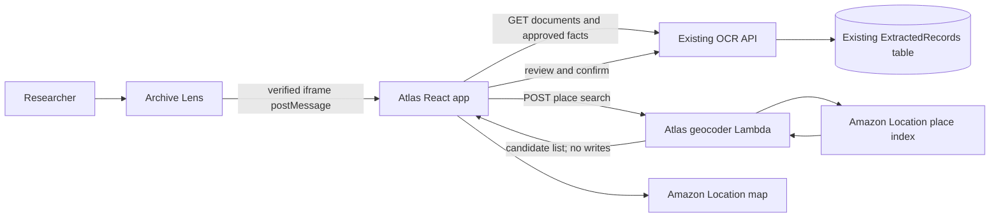

# BREATHE Research Atlas

The Research Atlas is a standalone React/Vite microfrontend for exploring approved
historical facts by location. It is designed to be hosted independently (for example
with AWS Amplify) and embedded in the BREATHE Archive Lens application.

The Atlas backend and frontend are deployed in AWS `ap-southeast-2`. The app is
available at `https://main.d1g1u8rtpgjn48.amplifyapp.com`; the Amazon Location map,
restricted browser map key, geocoding Lambda, HTTP API, and retrieval Lambda geotag
validation are also provisioned.

## Architecture



Atlas reads approved facts from the existing BREATHE API. Geocoding only returns
candidates; a researcher explicitly reviews a match before the existing record API
saves its `geotag` attribute. The current retrieval Lambda change that validates and
authorizes geotag updates remains part of the BREATHE application repository, not
this standalone repository; deploy that companion backend change before enabling
geotag writes.

## Repository layout

| Path | Purpose |
|---|---|
| `frontend/` | Standalone, responsive React/Vite Atlas app and OpenLayers Canvas map viewer. |
| `backend/lambda_geocode.py` | Protected candidate-only Amazon Location text geocoder. |
| `backend/test_lambda_geocode.py` | Geocoder unit tests. |
| `backend/README.md` | Lambda contract and deployment requirements. |
| `frontend/README.md` | Local development, environment, and Amplify setup. |
| `integration/archive-lens/` | Parent iframe bridge and integration notes. |

## Quick start

```bash
cd frontend
npm ci
cp .env.example .env.local
npm run dev
```

When opening Atlas inside Archive Lens, use the parent app's Atlas tab. The signed-in
token is sent through a source- and origin-checked `postMessage`; it is never placed
in the URL. The local development app defaults to the parent at `http://localhost:3000`
if opened directly without an iframe referrer.

See [frontend setup and Amplify configuration](./frontend/README.md) and
[geocoder Lambda setup](./backend/README.md) and
[Archive Lens integration](./integration/archive-lens/README.md).

## Data contract

Each existing fact may include multiple additive geotags; original fields and
`spatial_units` text are preserved:

```json
{
  "place_name": "Bidar",
  "place_type": "district",
  "label": "Bidar, Karnataka, India",
  "latitude": 17.9,
  "longitude": 77.5,
  "provider": "Amazon Location Service",
  "place_id": "provider-place-id",
  "relevance": 0.94,
  "status": "confirmed",
  "updated_at": "2025-01-01T00:00:00Z"
}
```

Only records with `review_status=approved` are shown. Only geotags with
`status=confirmed` appear as map markers. Future IMD, land-surface-temperature,
satellite, and remote-sensing layers should be independent data layers with their own
timestamps and provenance.

## AWS naming and deployment boundary

Use the `jrf-task-atlas-*` prefix for the Lambda, API, IAM roles, place index, map,
map API key, and Amplify app. The target region is `ap-southeast-2`. Restrict the
browser map key to local and deployed Atlas origins and map-only operations.
Configure the Lambda with the protected shared `JWT_SECRET`, current users-table read
access, the place index name, and the exact Atlas CORS origins.

Provisioned resources (region `ap-southeast-2`):

| Resource | Name / URL |
|---|---|
| Amazon Location map | `jrf-task-atlas-map` (`VectorEsriStreets`) |
| Amazon Location place index | `jrf-task-atlas-place-index` (Esri, storage intended use) |
| Map key | `jrf-task-atlas-browser-key`, map-only and restricted to localhost plus Amplify |
| Geocoder Lambda | `jrf-task-atlas-geocode` (`lambda_geocode.lambda_handler`) |
| HTTP API | `jrf-task-atlas-api` — `https://iz37e4zn02.execute-api.ap-southeast-2.amazonaws.com` |
| Atlas Amplify app | `https://main.d1g1u8rtpgjn48.amplifyapp.com` |
| Existing OCR API CORS | Local Atlas and Amplify origins allowed; production stage deployed |
| Existing retrieval Lambda | `jrf-task-ocr-retrieval` updated with permission-gated `geotag` validation |

Amazon Location searches and map requests use request-based pricing. Check the AWS
console for current usage and pricing. No records have been geotagged by deployment;
place data is written only after an authenticated researcher confirms a candidate.
The deployed Atlas origin is allowed in the map-key referrers, Atlas API CORS,
existing OCR API CORS, and geocoder Lambda `ALLOWED_ORIGINS`.
